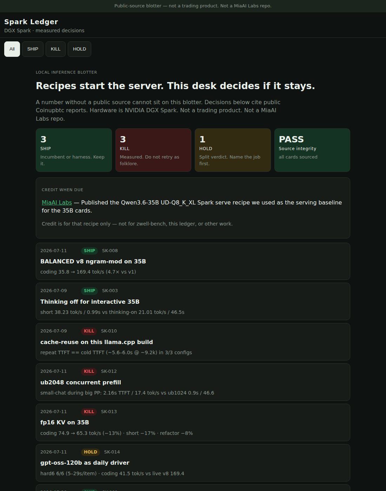

# Spark Ledger



## At a glance

| | |
|---|---|
| **What it is** | A public-source **ship / kill / hold** blotter for local Spark inference — every number cites a report. |
| **What it’s for** | Show how you decide. Recipes get a model running. This desk keeps the ones that measure, and kills the ones that don’t. |
| **How to use it** | `./setup.sh` → http://127.0.0.1:8767/ or open `index.html`. Click a row. Follow the source link. |

**GitHub description:** What: ship/kill blotter for local Spark models. For: decide with public numbers, not vibes. How: `./setup.sh`.

## Try it

```bash
git clone https://github.com/Coinupbtc/spark-ledger.git
cd spark-ledger
chmod +x setup.sh
./setup.sh
# open http://127.0.0.1:8767/
```

Or open **[the GitHub Pages build](https://coinupbtc.github.io/spark-ledger/)**.

`./scripts/smoke.sh` checks the headline, a SHIP number, a KILL card, and source integrity.

## How to read it

| Stamp | Meaning |
|---|---|
| **SHIP** | Incumbent or harness. Keep it. |
| **KILL** | Measured miss. Do not retry as folklore. |
| **HOLD** | Split verdict. Name the job before you crown a winner. |

Integrity rule on the blotter: a card without an `https://` source cannot ship. That is the same instinct as Helix QMS Desk (*presence is not integrity*) applied to tok/s.

## Credit when due

[MiaAI Labs](https://github.com/MiaAI-Lab) published the [Qwen3.6-35B UD-Q8_K_XL Spark serve recipe](https://github.com/MiaAI-Lab/Qwen3.6-35B-A3B-UD-Q8_K_XL_DGX-Spark-Recipe) used as the **serving baseline** for the 35B cards. This repo is the decision journal on top of that recipe — not a fork, not a general endorsement, and not related to Helix, zwell-bench, or Spark Console.

## Photos

| Screen | File |
|---|---|
| Blotter | `docs/screenshots/overview.png` |
| SHIP ticket | `docs/screenshots/ship-v8.png` |
| Phone 390×844 | `docs/screenshots/phone-overview.png` |

## Resume one-liner

Published a ship/kill ledger for local Spark serving: 4.7× coding tok/s kept, cache-reuse and fp16 KV killed on A/B, gpt-oss-120b held as a specialist — every figure linked to a public report.

## License

MIT
